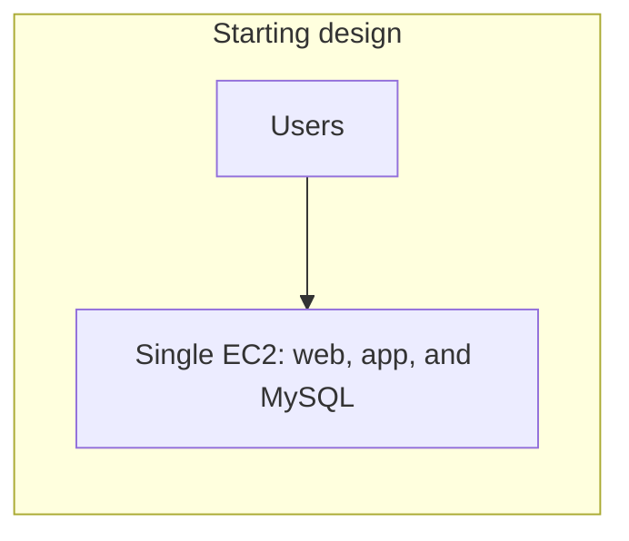
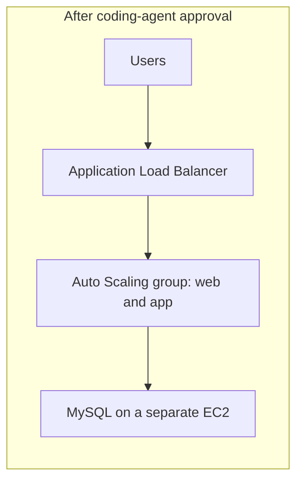
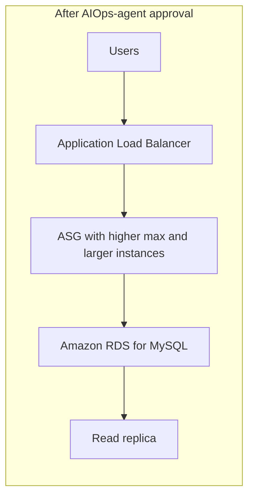
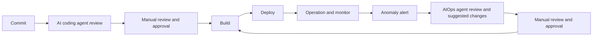

# AIOps Project Proposal

**Name:** Aaron Gesmer  
**Course:** SEIS 616: AI-Driven Cloud Infrastructure, University of St. Thomas  
**Assignment:** AIDev-AIOps Project proposal  
**Date:** November 9, 2026  
**Due:** Monday, November 16, 2026, 5:30 p.m. Central  
**Canvas:** [AIOps Project Proposal](https://stthomas.instructure.com/courses/89528/assignments/1372038)

This is a plan, not a report on work I have already built. Choices marked TBD are ones I still need to lock in.

## Overview

I am proposing an AIDev-AIOps system that follows the project brief: commit, AI coding agent review, manual approval, build, deploy, operate and monitor, anomaly alert, AIOps agent review and suggested changes, then another manual approval.

The demo combines both example scenarios from the brief. I will start with a three-tier LAMP-style web app on a single EC2 instance. At commit time, an AI coding agent will review the infrastructure as code, flag design problems already visible in the template, and propose separate tiers, an Application Load Balancer, and an Auto Scaling group. I will approve that change and deploy it. The database will still be self-managed MySQL on its own EC2 host, so a later operational problem can still appear there.

During the demo I will run a short load test. CloudWatch alarms should fire for two issues at once: the database becoming a bottleneck, and the Auto Scaling group hitting its maximum with undersized instances that are still short on CPU. An AIOps agent will investigate the metrics and logs and suggest moving the database to Amazon RDS with a read replica, plus a higher Auto Scaling max and a larger instance type. I will approve that change, redeploy, and show the metrics recover.

The coding agent handles problems we can see in the design before deploy. The AIOps agent handles problems that only show up under load. I will describe both with AWS Well-Architected patterns and anti-patterns.

## System plan

**Starting anti-pattern.** A LAMP-style site (Linux, Apache, MySQL, and a simple PHP or similar app) runs on one EC2 instance. This matches the CDK practices lab: a VPC, security groups, and user data that installs a LAMP server. Web, app, and database share the same machine, with no load balancer or Auto Scaling group.

**After the coding-agent change.** The web and app tier moves behind an Application Load Balancer and an Auto Scaling group. MySQL moves to a separate EC2 instance, still self-managed. That covers the first half of both example scenarios without jumping all the way to a managed database.

**After the AIOps-agent change.** The self-managed database is replaced with Amazon RDS for MySQL and a read replica. The Auto Scaling group gets a higher maximum and a larger instance type. Traffic still enters through the load balancer.

Suggested changes from either agent only go live after I approve them, which matches the brief:

The Change Management Pipelines lecture describes a deployment pipeline as a set of validation stages on every code change, including a stop for a manual check, and notes that CI/CD can build infrastructure, not just application code. AWS CodePipeline includes an Approval action. The Software Delivery Pipeline homework already asked us to add a manual review stage after check-in, using GitHub, CodeBuild, and CodePipeline. I will keep that gate here.

| Area | Proposed choice | Notes |
| --- | --- | --- |
| Infrastructure as code | AWS CDK, Python | Course default. CDK defines infrastructure in code and provisions it through CloudFormation. Terraform is also in the course; I will stay with CDK unless I change my mind. |
| Starting workload | LAMP-style site on EC2 | Same general pattern as the CDK lab. Exact app code is TBD. |
| Region and account | Same student account as earlier labs, likely `us-east-1` | Confirm at implementation time. |
| CI/CD | TBD: GitHub Actions, or GitHub + CodeBuild + CodePipeline | Either option will require manual approval before deploy. |
| Monitoring | CloudWatch metrics, logs, and alarms | The Integration Management lecture covers CloudWatch metrics, logs, threshold alarms, and events, plus Auto Scaling from CloudWatch alarms and SNS for alert delivery. |
| Alarm trigger | CloudWatch alarm to SNS and EventBridge, then a Lambda or a GitHub Actions workflow | The Serverless lecture lists SNS and CloudWatch as Lambda event sources. Exact wiring is TBD. |
| AI coding agent | TBD: Cursor, Claude Code, or GitHub Copilot code review | Reviews IaC on commit or in a pull request. Does not deploy on its own. |
| AIOps agent | Start from the Session 01 AIOps lab; model and product TBD | The lab uses Amazon Bedrock Agents, Lambda action groups, CloudWatch alarm lookup, and a knowledge-base runbook. I will confirm whether I can still extend those lab agents in my account. If not, I will run an equivalent flow with a Bedrock foundation model invoked from Lambda or a workflow, still reading metrics and logs and opening a suggested-change PR. |
| MCP and knowledge | Optional and TBD | Possible sources: the lab runbook, the [AWS Knowledge MCP Server](https://github.com/awslabs/mcp/), or the [Agent Toolkit for AWS](https://aws.amazon.com/products/developer-tools/agent-toolkit-for-aws/). |
| Load test | TBD (for example `hey` or Locust) | Short, demo-sized traffic, not a long soak test. |
| Secrets and network | Security groups; Secrets Manager if I use RDS | The Orchestration lecture notes that Secrets Manager integrates with RDS. The database will not be public. |

## Demo story

1. **Show the starting anti-pattern.** I commit CDK that places the whole stack on one EC2 instance and explain why that is a weak design: one host is a single point of failure, the database shares CPU and disk with the web server, and there is no way to scale or shift traffic if that instance gets busy or fails.

2. **Coding agent review.** The agent reads the IaC, not the running system, and should flag a single instance, no load balancer or Auto Scaling group, and a co-located database. It should propose an ALB, an Auto Scaling group, and MySQL on a separate EC2 instance. I will keep the suggestion in a pull request or pipeline review. The prompt will tell it not to recommend RDS yet, so the operations half of the story still has something to catch.

3. **I approve, then build and deploy.** Nothing is applied until I approve it. After deploy, the site should be reachable through the load balancer, with MySQL off the web hosts.

4. **Operate and drive load.** I start a load test and watch CloudWatch. I expect alarms on database CPU, connections, or read latency, and on an Auto Scaling group that is already at max with high CPU on instances that are still too small.

5. **AIOps agent review.** The alarm path triggers the agent. It should pull the relevant metrics and logs, name both problems, and open a suggested change: RDS for MySQL plus a read replica, a higher Auto Scaling maximum, and a larger instance type. It may also suggest sending read traffic to the replica. It will not apply the change on its own.

6. **I approve, redeploy, and show recovery.** I rerun a similar load and show the alarms clear or the metrics improve.

### Anti-patterns and patterns

The brief says to use the AWS Well-Architected Framework for patterns and anti-patterns. The Framework is a set of design practices for reliable, secure, efficient, cost-effective, and sustainable systems ([overview](https://docs.aws.amazon.com/wellarchitected/latest/framework/welcome.html); [six pillars](https://aws.amazon.com/architecture/well-architected/)).

| Stage | Anti-pattern | Pattern | Pillar |
| --- | --- | --- | --- |
| Design; coding agent | Entire site on one instance; no redundancy | Separate the web and app tier from the database; run web instances in an Auto Scaling group behind an ALB, which distributes traffic and routes only to healthy targets ([ALB](https://docs.aws.amazon.com/elasticloadbalancing/latest/application/introduction.html); [EC2 Auto Scaling](https://docs.aws.amazon.com/autoscaling/ec2/userguide/what-is-amazon-ec2-auto-scaling.html)) | [Reliability](https://docs.aws.amazon.com/wellarchitected/latest/reliability-pillar/welcome.html). That pillar calls out single points of failure and a lack of elasticity. The Integration Management lecture also describes cloud-native apps as using managed services and deploying across Availability Zones. |
| Design; coding agent | No automated scaling | Dynamic Auto Scaling from CloudWatch metrics and alarms, as covered in the Integration Management lecture | Reliability and [Performance Efficiency](https://docs.aws.amazon.com/wellarchitected/latest/performance-efficiency-pillar/welcome.html) |
| Operations; AIOps agent | Self-managed MySQL on EC2 becomes a CPU, connection, or latency bottleneck | Amazon RDS with a [read replica](https://docs.aws.amazon.com/AmazonRDS/latest/UserGuide/USER_ReadRepl.html) so read traffic can move off the primary | Performance Efficiency and Reliability |
| Operations; AIOps agent | Auto Scaling is already at max, and the instance type still does not have enough CPU | Raise the group maximum and use a larger instance type, then confirm with another load test | Performance Efficiency and [Cost Optimization](https://docs.aws.amazon.com/wellarchitected/latest/cost-optimization-pillar/welcome.html) (scale only as far as the demo needs, then tear down) |
| Whole pipeline | Changes go straight out with no review | Manual approval before every deploy; the AIOps agent suggests a change instead of applying it | [Operational Excellence](https://docs.aws.amazon.com/wellarchitected/latest/operational-excellence-pillar/welcome.html): monitor the system, respond to events, and automate change with a controlled process. This also follows Design for Operations in the DevOps Practices lecture: ask how the feature will scale and stay available, and give operators metrics, logs, and a way to push a corrective update. |

## How the two agents work

Both agents suggest. I approve. The brief puts a manual review after each agent, and I want the live demo to show that gate clearly.

**AI coding agent (design time).** Inputs are the committed CDK and a short review prompt. If I enable MCP, it may also consult current AWS docs. At a high level, the prompt will say: review this infrastructure against Well-Architected; flag single-instance, missing load balancing or Auto Scaling, and a co-located database; propose a concrete CDK change (ALB, Auto Scaling group, separate database instance); do not recommend RDS yet; do not apply the change. Output is comments and a proposed patch or pull request. I review and approve, then the pipeline builds and deploys.

**AIOps agent (run time).** Inputs are the CloudWatch alarm event, metrics and logs for the database and Auto Scaling group, the current IaC, and any runbook I attach. The Session 01 lab already looks up alarms and uses a runbook, and I may reuse or adapt that. At a high level, the prompt will say: investigate the firing alarms; separate a database bottleneck from an Auto Scaling ceiling or undersized instance; propose an IaC change (RDS with a read replica, higher Auto Scaling max, larger instance type); cite the metrics you used; open a pull request or otherwise record the suggestion; do not apply it. I review and approve, then the same build and deploy path runs again.

Exact agent names, versions, models, skills, MCP servers, and knowledge bases will go in the final report, as the brief requires.

## Optional evaluation

If I have time after the main path works, I may compare a couple of models or prompt variants on the same review and see whether they flag the same anti-patterns and make a reasonable fix. That is optional in the brief, and I will only include it if the results are clear enough to discuss in the report.

## Timeline

The proposal is due Monday, November 16. The live demo and final report are due Monday, December 14.

| When | Plan |
| --- | --- |
| By Nov 16 | Turn in this proposal on Canvas, after I edit anything that still looks off. |
| Nov 16–22 | Scaffold the CDK app and the starting single-instance stack. Stand up the pipeline with a manual approval step. |
| Nov 23–29 | Hook up the AI coding agent review, approve the ALB and Auto Scaling change, and deploy it. Add CloudWatch alarms and a first load-test run. |
| Nov 30–Dec 6 | Wire the alarm trigger to the AIOps agent so it can diagnose both failures and open a suggested change. Practice the RDS and Auto Scaling follow-up deploy. |
| Dec 7–13 | Run the full story end to end, tighten prompts, tear down and rebuild once to make sure I can recover, and write the final report (repo link, prompts, environment settings, scenario, citations). |
| Dec 14 | Live demo in class and submit the report on Canvas. |

## Risks and cost controls

I will keep this small and short-lived: small instance types, a low Auto Scaling cap until the demo itself, and a small RDS instance and replica only when I need them. I will set an AWS Budget or a billing alarm, and I will tear the stack down with `cdk destroy` (or the equivalent) after practice runs and after the demo. I will not leave the load test running, and I will not open the database to the public internet.

The main risks I already see: the coding agent might recommend RDS too early and weaken the operations half of the story; the load test might fail to trip both alarms in a short demo window; and I may need a backup plan if I cannot extend the Session 01 Bedrock Agents lab as-is. I will keep the prompts explicit, tune alarm thresholds with practice runs, and have a fallback AIOps path ready (a Bedrock model plus Lambda or a workflow) if the lab agents are not a good fit.

## References

Course materials, all in this repository unless noted:

- Chiang, R. C. *AIDev-AIOps Project* brief. `assignments/AIOps Project.pdf`.
- Chiang, R. C. *Infrastructure as Code: Cloud Development Kit* (CDK basics). `lectures/infrastructure-CDK basics.pdf`.
- Chiang, R. C. *Infrastructure as Code: CDK Practices*. `lectures/infrastructure-CDK practices.pdf`.
- Chiang, R. C. *Change Management Pipelines for Infrastructure*. `lectures/infrastructure-Change Management Pipelines for Infrastructure.pdf`.
- Chiang, R. C. *DevOps Practices*. `lectures/infrastructure-DevOps Practices.pdf`.
- Chiang, R. C. *Integration, Management & Cloud-native Patterns*. `lectures/infrastructure-Integration Management and Cloud-native Patterns.pdf`.
- Chiang, R. C. *Serverless*. `lectures/infrastructure-Serverless.pdf`.
- Chiang, R. C. *Orchestration*. `lectures/infrastructure-Orchestration.pdf`.
- Session 01 AIOps lab materials, including `labs/session_01/aiops-bedrock-resources.yml`, the alarm and remediation schemas, and the EC2 runbook.
- Software Delivery Pipeline homework brief. `assignments/HW - Software Delivery Pipeline.pdf`.

AWS and other documentation:

- AWS. *AWS Well-Architected Framework*. https://docs.aws.amazon.com/wellarchitected/latest/framework/welcome.html
- AWS. *AWS Well-Architected* (six pillars). https://aws.amazon.com/architecture/well-architected/
- AWS. *Reliability Pillar*. https://docs.aws.amazon.com/wellarchitected/latest/reliability-pillar/welcome.html
- AWS. *Performance Efficiency Pillar*. https://docs.aws.amazon.com/wellarchitected/latest/performance-efficiency-pillar/welcome.html
- AWS. *Operational Excellence Pillar*. https://docs.aws.amazon.com/wellarchitected/latest/operational-excellence-pillar/welcome.html
- AWS. *Cost Optimization Pillar*. https://docs.aws.amazon.com/wellarchitected/latest/cost-optimization-pillar/welcome.html
- AWS. *What is an Application Load Balancer?* https://docs.aws.amazon.com/elasticloadbalancing/latest/application/introduction.html
- AWS. *What is Amazon EC2 Auto Scaling?* https://docs.aws.amazon.com/autoscaling/ec2/userguide/what-is-amazon-ec2-auto-scaling.html
- AWS. *Working with DB instance read replicas*. https://docs.aws.amazon.com/AmazonRDS/latest/UserGuide/USER_ReadRepl.html
- AWS. *Using Amazon CloudWatch alarms*. https://docs.aws.amazon.com/AmazonCloudWatch/latest/monitoring/AlarmThatSendsEmail.html
- AWS. *What is Amazon EventBridge?* https://docs.aws.amazon.com/eventbridge/latest/userguide/eb-what-is.html
- AWS. *Automate tasks in your application using AI agents* (Amazon Bedrock Agents). https://docs.aws.amazon.com/bedrock/latest/userguide/agents.html
- AWS Labs. *Open source MCP servers for AWS*. https://github.com/awslabs/mcp/
- AWS. *Agent Toolkit for AWS*. https://aws.amazon.com/products/developer-tools/agent-toolkit-for-aws/
